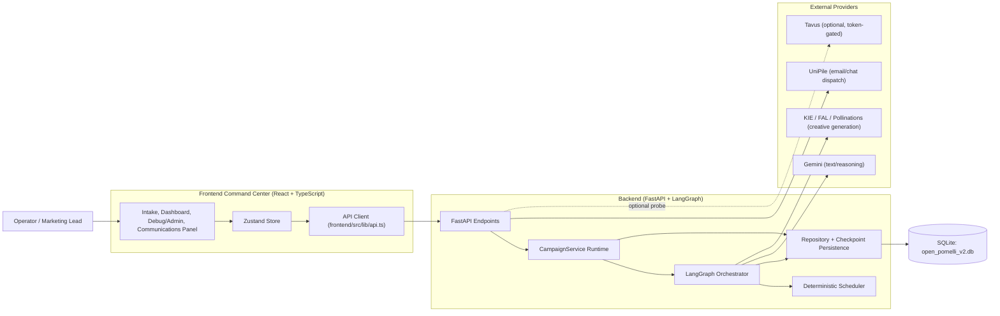
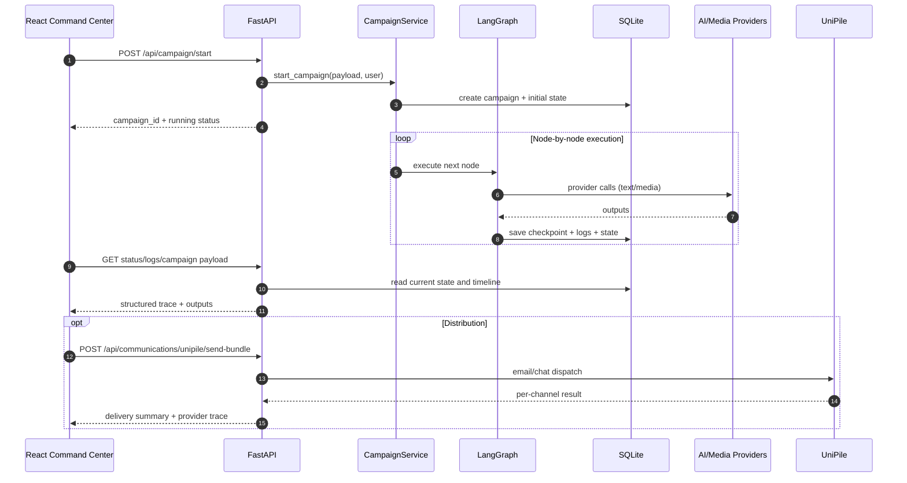
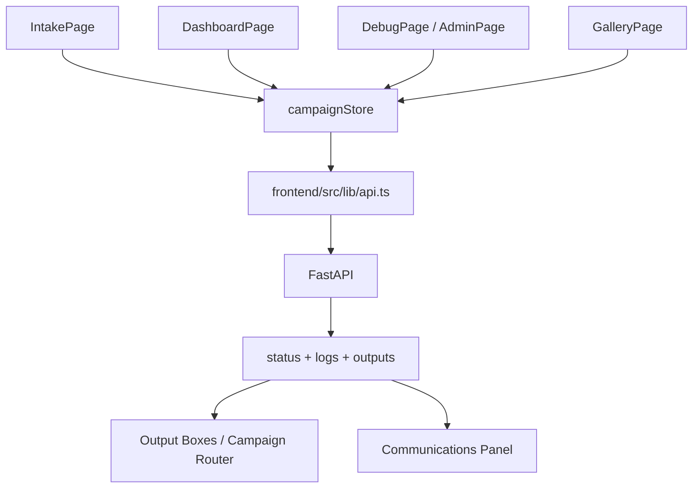
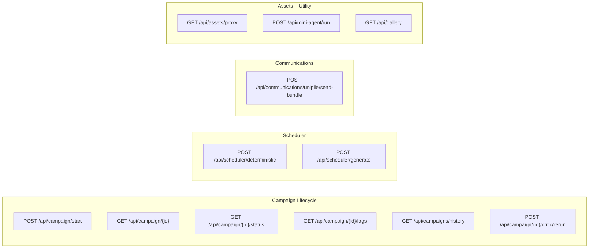
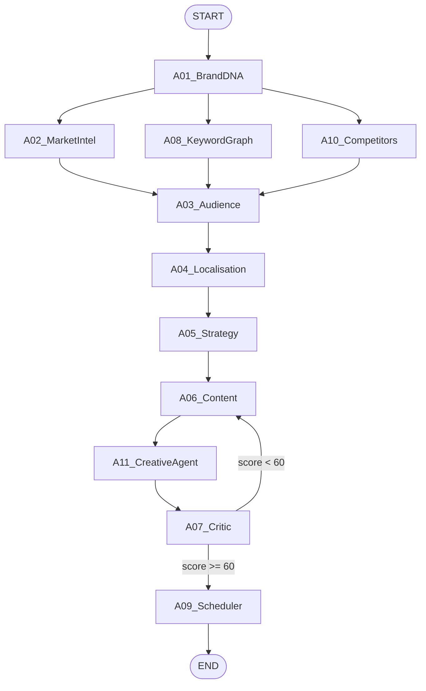
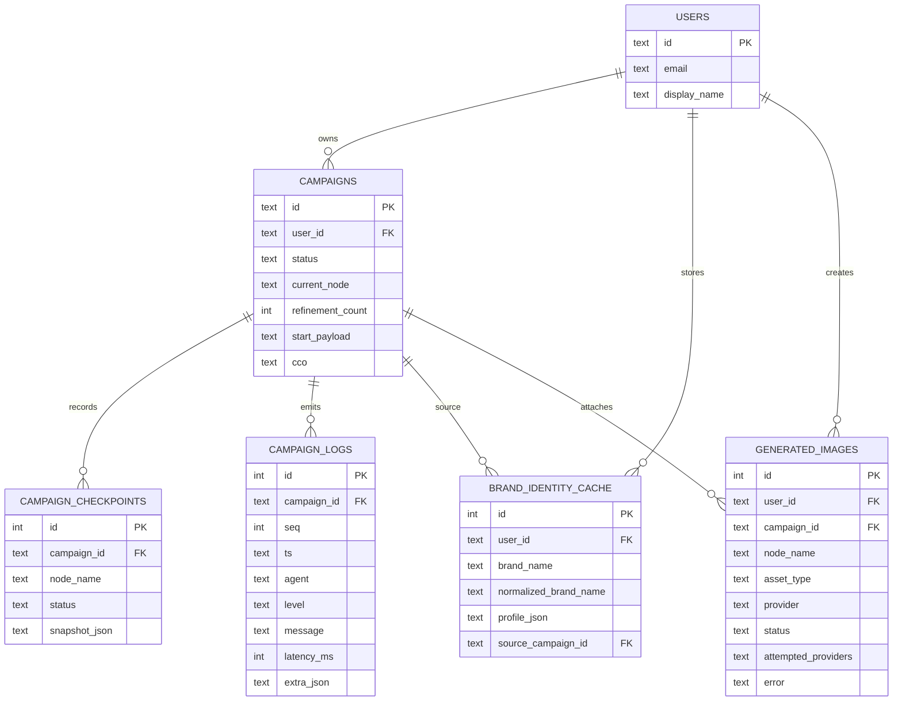
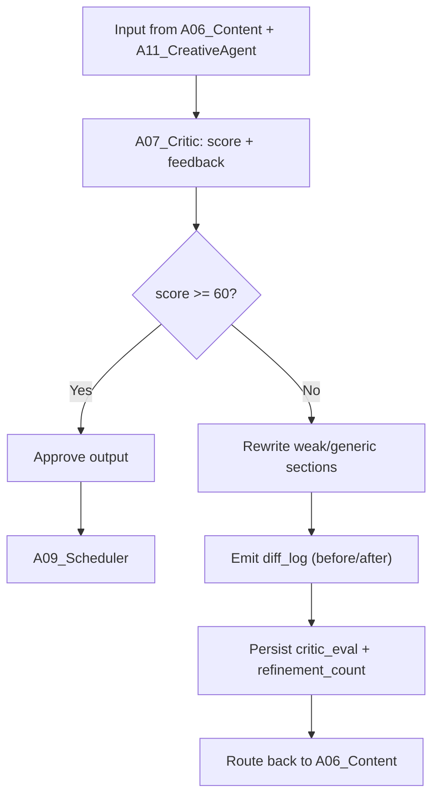
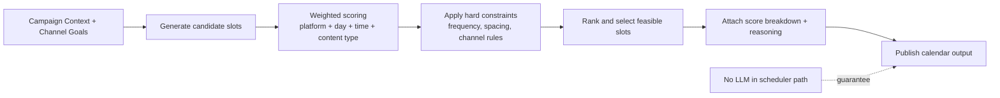
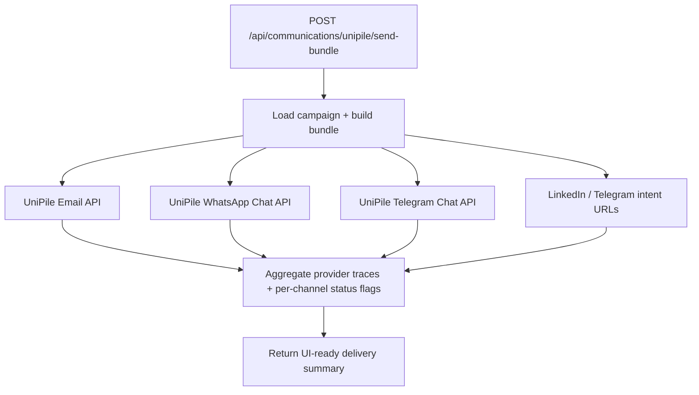

# Open-Pomelli

Open-Pomelli is a full-stack, multi-agent marketing orchestration system with a LangGraph backend, FastAPI API layer, and React command center. It generates localized campaign strategy, assets, and publishing schedules with deterministic checkpoints, critic-based quality control, and deep execution traceability.

This README is the single source of truth for architecture, execution flow, iteration/retry behavior, hallucination checking, tech stack, and operational runbooks.

## 0) Full Mermaid Architecture Pack

The diagrams below are intended to render directly in GitHub and VS Code Markdown preview.

### 0.1 System Context (Frontend -> API -> Orchestrator -> Providers)



### 0.2 End-to-End Execution Sequence



## 1) What This System Does

- Ingests brand and campaign intent from an operator UI.
- Runs a multi-agent graph to produce strategy, content, creatives, and schedule.
- Applies critic quality control before finalization.
- Produces deterministic publish calendars via scoring + constraints.
- Supports outbound campaign bundle dispatch to communication channels.
- Persists every major execution step for audit/debug/resume.

## 2) Repository Structure (Cleaned)

```text
Open-Pomelli/
  backend/                     # FastAPI API, LangGraph orchestration, scheduler, persistence
  frontend/                    # React + TS dashboard, intake, debug/admin pages
  scripts/                     # Dev/runtime helper scripts
  tests/                       # Automated validation (scheduler + backend logic)
  docs/                        # Visual architecture artifacts (Mermaid/diagram assets)
  artifacts/                   # Generated run artifacts
  legacy/                      # Older standalone script-era marketing modules
  adapters.py                  # Provider adapters used by legacy/runtime pathways
  api_secrets.py               # Local secret fallback (dev only; do not commit secrets)
  requirements.txt             # Python dependencies
  LICENSE
  README.md                    # You are here
```

### Notes on Cleanup

- Legacy standalone modules were moved from root into `legacy/` to reduce root-level clutter.
- Redundant markdown docs were removed and consolidated into this README.
- Runtime-critical backend/frontend paths were not changed.

## 3) End-to-End Architecture

## 3.1 Frontend Layer

Key responsibilities:
- Campaign intake and request shaping.
- Campaign history, status, logs, and output rendering.
- Scheduler result visualization.
- Communications panel (email/WhatsApp/Telegram/LinkedIn handoff UX).
- Debug/admin pages for execution introspection.

Core frontend areas:
- `frontend/src/pages` for workflow pages.
- `frontend/src/components/boxes` for output modules.
- `frontend/src/store/campaignStore.ts` for state orchestration.
- `frontend/src/lib/api.ts` for backend API contract calls.

Frontend page and data flow:



## 3.2 API Layer (FastAPI)

Core API responsibilities:
- Auth-aware request handling.
- Campaign lifecycle endpoints.
- Scheduler endpoints.
- Communications endpoints.
- Asset proxy and mini-agent utility endpoints.

Representative endpoints:
- `POST /api/campaign/start`
- `GET /api/campaign/{campaign_id}`
- `GET /api/campaign/{campaign_id}/status`
- `GET /api/campaign/{campaign_id}/logs`
- `GET /api/campaigns/history`
- `POST /api/campaign/{campaign_id}/critic/rerun`
- `POST /api/scheduler/deterministic`
- `POST /api/scheduler/generate`
- `POST /api/communications/unipile/send-bundle`
- `POST /api/mini-agent/run`

API surface map:



## 3.3 Orchestration Layer (LangGraph)

Graph order:
- A01_BrandDNA
- A02_MarketIntel
- A08_KeywordGraph
- A10_Competitors
- A03_Audience
- A04_Localisation
- A05_Strategy
- A06_Content
- A11_CreativeAgent
- A07_Critic
- A09_Scheduler

Behavior:
- Fan-out and fan-in stages for parallel market intelligence phases.
- Deterministic node identity and progress tracking.
- Node-level logs with timings and structured metadata.
- State checkpointing after transitions.

Complete LangGraph topology (runtime-accurate):



## 3.4 Persistence Layer

Storage model:
- SQLite campaign state persistence.
- Checkpoint snapshots for recoverability.
- Node logs for timeline reconstruction.
- Brand identity cache and generated asset records.

Primary runtime DB default:
- `open_pomelli_v2.db`

Persistence entity map:



## 4) Hallucination Checker Architecture (Critic Gate)

The system-level hallucination and quality guardrail is implemented through the critic stage (`A07_Critic`) and explicit revision control.

Mechanics:
- Critic computes quality score and review feedback.
- Critic can rewrite low-quality/generic content sections.
- Critic emits a `diff_log` (`before`/`after`) for explainability.
- `refinement_count` tracks whether revision occurred.
- Critic feedback is persisted in `critic_eval`.

Why this is a hallucination-control mechanism:
- Detects weakly grounded or generic outputs.
- Forces market-specific trust cues and stronger CTA detail when needed.
- Preserves auditable traces of transformed output instead of silent mutation.

Current practical behavior:
- High-quality outputs pass directly.
- Low-score outputs are revised with explicit revision notes.
- Manual rerun endpoint exists for operator-triggered critic reevaluation.

Critic gate and revision loop:



## 5) Iteration, Retry, and Reiteration Controls

## 5.1 Model Fallback and Retry

Gemini execution model selection and fallback are resilient by design:
- Candidate chain attempts multiple model variants.
- Retry on transient rate-limit conditions.
- Skip invalid/unavailable model responses.
- Surface attempted-model trace for postmortems.

## 5.2 Image Provider Routing

Provider behavior:
- KIE-first defaults for primary image generation.
- Ordered provider fallback options available.
- Strict mode avoids silent fallback and returns explicit failure trace.

## 5.3 Critic Revision Loop

Critic reiteration path:
- Score and revision decision in `A07_Critic`.
- Optional rewrite payload emitted with `diff_log`.
- Revision count increments with transparent state updates.

## 5.4 Scheduler Determinism

Scheduler is intentionally non-LLM and deterministic:
- Weighted scoring by platform, day, time, content type.
- Constraint pass to avoid invalid slot combinations.
- Explainable reasons and score breakdown per slot.
- Identical inputs produce identical schedules.

Deterministic scheduling pipeline:



## 5.5 Channel Dispatch Reliability

Communications dispatch includes:
- Fixed recipient enforcement.
- Provider trace payload for each channel.
- Per-channel success flags (`email_sent`, `whatsapp_sent`, `telegram_sent`).
- Fast UI feedback with backend error detail propagation.

## 6) Communications + Distribution Architecture

Current communication pathways:
- Email dispatch through UniPile email API.
- WhatsApp/Telegram chat dispatch using UniPile chat APIs.
- LinkedIn and Telegram intent URLs generated for direct operator action.

Bundle composition includes:
- Campaign summary and promotion text.
- Brand identity highlights.
- Palette and poster references.
- Channel-specific message formatting.

Channel dispatch flow:



## 7) Tavus API Status Check (Current)

Validation run date:
- 2026-04-12

Observed result:
- Endpoint reachability is working.
- Request to Tavus v2 endpoint returned `401` with message `Invalid access token`.

Interpretation:
- Network path to Tavus is healthy.
- Auth is not configured (missing or invalid Tavus token in environment).

How to complete Tavus verification:
1. Export a valid Tavus API key in shell or backend env.
2. Re-run authenticated endpoint probe.
3. Confirm `2xx` response with expected payload shape.

## 8) Tech Stack

| Layer | Primary Tools | Responsibility |
|---|---|---|
| Frontend | React, TypeScript, Vite, Zustand, Clerk (optional) | Operator UI, campaign intake, run status, logs, outputs, communications handoff |
| API | FastAPI, Pydantic | Auth-aware endpoints, campaign lifecycle, scheduler and communications APIs |
| Orchestration | LangGraph, LangChain-style patterns | Multi-agent DAG execution, critic loop routing, deterministic node sequencing |
| Runtime | Python, asyncio, httpx | Async execution, provider I/O, service-level orchestration |
| Persistence | SQLite (open_pomelli_v2.db) | Campaign state, checkpoints, logs, identity cache, generated asset metadata |
| AI/Reasoning | Gemini | Strategy/content/analysis generation and reasoning steps |
| Media Generation | KIE, FAL, Pollinations | Creative and visual asset generation with provider fallback |
| Communications | UniPile | Email, WhatsApp, Telegram campaign bundle dispatch |
| Optional Integrations | Tavus, external search/enrichment | Optional runtime enhancements and channel-specific capabilities |

Frontend:
- React
- TypeScript
- Vite
- Zustand
- Clerk (optional auth mode)

Backend:
- Python
- FastAPI
- LangGraph / LangChain-style orchestration patterns
- httpx
- SQLite

AI/Media/External:
- Gemini (text + reasoning)
- KIE/FAL/Pollinations pathways for creative generation
- UniPile for communications dispatch
- Optional external search/enrichment integrations

## 9) Feature Inventory

Campaign intelligence and generation:
- Brand DNA extraction and normalization
- Market intelligence and competitor synthesis
- Keyword graph generation
- Locale adaptation
- Strategy generation
- Content and creative generation

Quality and control:
- Critic diff and revision trace
- Deterministic scheduler scoring and constraints
- Restart-safe persistence and status polling

Operator and admin surfaces:
- Intake flow
- Dashboard output boxes
- Debug/trace views
- Campaign history restore behavior
- Communications action panel

## 10) Local Runbook

Backend:
```bash
python3 -m uvicorn backend.app:app --host 127.0.0.1 --port 8000
```

Frontend:
```bash
cd frontend
npm run dev -- --host 127.0.0.1 --port 5173
```

Full stack helper:
```bash
./scripts/run_full_stack.sh
```

Frontend production build:
```bash
cd frontend
npm run build
```

## 11) Security and Operational Notes

- Do not keep real API keys in committed files.
- Prefer environment variables over static secret files.
- Keep auth enabled outside local development.
- Use provider trace logs for failure triage.
- Persisted campaign records are operational data; back up DB before large migrations.

## 12) Future Hardening Priorities

- Move local secret fallback to strict env-based secret management.
- Add explicit Tavus integration module with healthcheck endpoint if Tavus becomes core runtime dependency.
- Expand critic gate to include citation/grounding confidence scoring.
- Add channel retry queues and idempotency keys for communications delivery.

